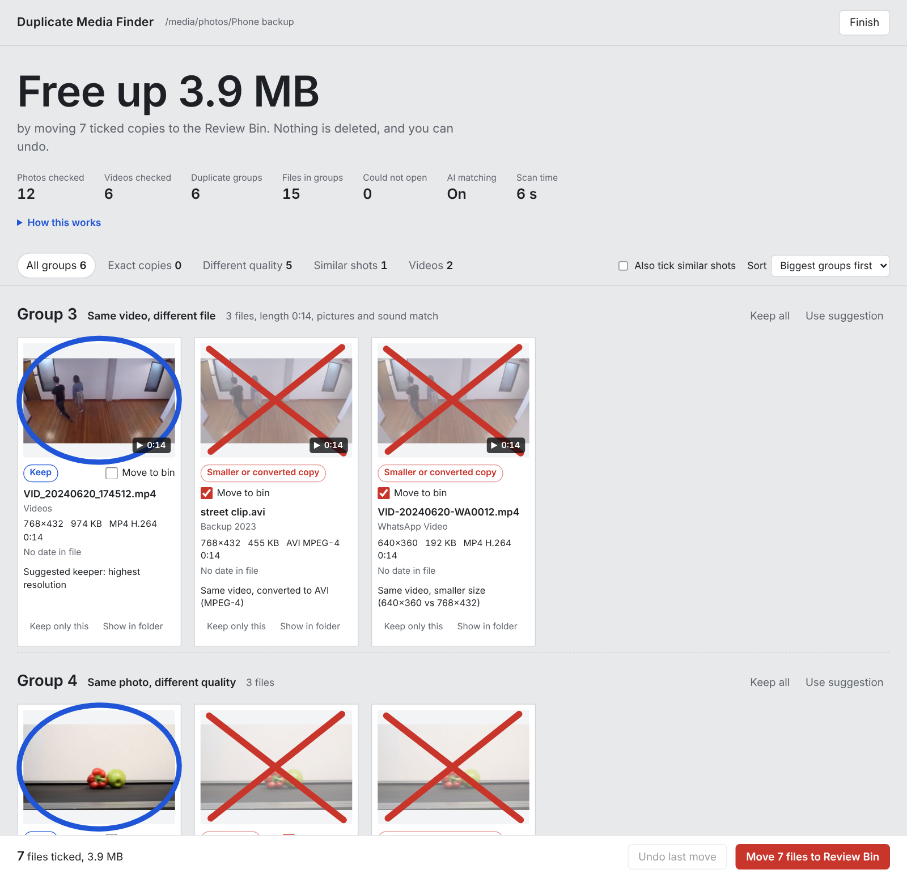
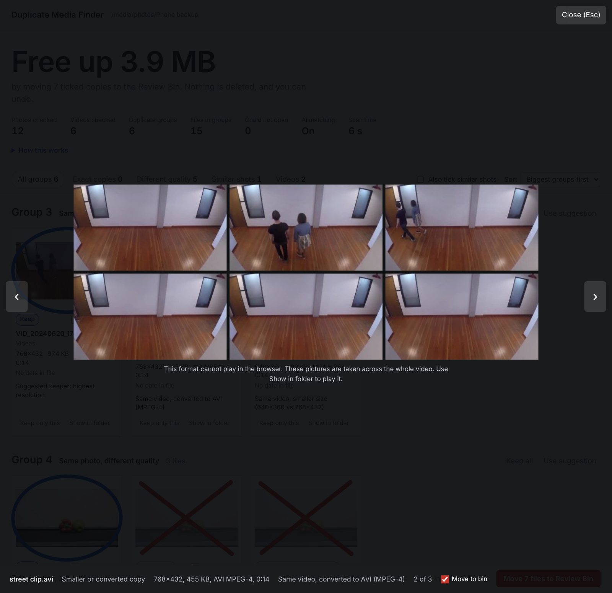

# Duplicate Media Finder: free duplicate photo and video finder

**Find and remove duplicate photos, similar images and duplicate videos** on Windows 10/11, macOS and Linux. Duplicate Media Finder scans a folder (and all its sub-folders), finds exact copies, resized and compressed copies, the same picture saved in another format, burst shots and re-encoded videos, then lets you review every group side by side before anything is moved. It is free, open source (MIT) and runs offline: your photos never leave your computer.

[](https://github.com/rzvky/Duplicate-Media-Finder/actions/workflows/tests.yml)
[](LICENSE)


<picture>
  <source media="(prefers-color-scheme: dark)" srcset="docs/images/review-dark.png">
  
</picture>

## Why not a normal duplicate file finder?

Most duplicate file finders only catch files that are byte-for-byte identical. Real photo libraries are messier: the same picture sits on your drive as the original HEIC from the iPhone, a JPG export, a WhatsApp copy at a quarter of the size and a backup in another folder, and every app that touches a video re-encodes it. A checksum sees five different files. Duplicate Media Finder compares what the files **look like** (and, for videos, how they sound), so it finds those duplicate images and videos too, and it suggests the best copy to keep: the original resolution, the camera's own format, the file with its date and camera details.

## What it finds

| Duplicate type | Example |
|---|---|
| **Exact duplicate files** | `IMG_1234.jpg` and `IMG_1234 - Copy.jpg` in another folder, under any file name |
| **Same photo in another size or format** | A 4 MB original and its 200 KB WhatsApp copy; a JPG saved again as PNG, WEBP, HEIC or AVIF; a photo downloaded again from Google Photos |
| **Similar photos** | Burst photos and near-duplicate retakes of the same scene (optional local AI model; never ticked for you) |
| **Duplicate videos** | `IMG_4021.MOV` and `VID-20240512-WA0003.mp4`; a video converted to MP4, AVI, MKV or WEBM, shrunk, re-encoded or with the sound removed |

Every file is compared with every other file, not only files with similar names or dates. Edited versions (filters, crops, a logo or subtitles, a trimmed video) are treated as different files on purpose, because you usually want to keep them.

Typical uses: removing duplicate pictures from years of phone backups, a `WhatsApp Images` folder, a Google Photos Takeout export or merged family photo folders, and finding duplicate images and videos on old external hard drives and camera SD card imports that were copied twice.

## Safe: nothing is deleted

- **Review before anything moves.** Files you choose go to a `Review_Bin` folder that keeps their folder layout, and **Undo** puts them back.
- **One file of every group always stays**, and files that changed after the scan are skipped.
- **Linked files move together:** iPhone Live Photo videos, `.AAE` edit files and `.XMP` / `.JSON` sidecars (Google Takeout) follow their photo. RAW + JPEG pairs are shown but never ticked.
- **Private and offline:** no upload, no account. The review screen runs on `127.0.0.1` only, protected by a random access key.

## Download and install (Windows, macOS, Linux)

You need [Python 3.10 to 3.13](https://www.python.org/downloads/) (3.12 recommended). On Windows, tick **"Add python.exe to PATH"** in the installer.

1. **Get the tool.** Download the ZIP from the [latest release](https://github.com/rzvky/Duplicate-Media-Finder/releases/latest) (under *Assets*, "Source code (zip)") and unzip it, or clone it:
   ```bash
   git clone https://github.com/rzvky/Duplicate-Media-Finder.git
   ```
2. **Optional: get the AI model** for similar photos. From the same release, download the four files `DuplicateMediaFinder_AI_part1of4.bin` to `part4of4.bin` (92 MB in total) and leave them in your Downloads folder. The tool finds them, checks them and puts them in place on the next start. Everything else works without the model.
3. **Start it:**

   | System | What to do |
   |---|---|
   | Windows 10 / 11 | Double-click `START_HERE_Windows.bat`. If "Windows protected your PC" appears, click **More info**, then **Run anyway**. |
   | macOS | Right-click `START_HERE_Mac.command`, choose **Open**, confirm. |
   | Linux | `bash start_linux.sh` |

The first start takes 2 to 5 minutes: it creates a private Python environment in a `.venv` folder (nothing is installed system-wide), installs the packages and checks what works. After that it starts straight away.

## How to find and remove duplicate photos

1. Start the tool and **choose the folder** with your photos (sub-folders are included). An external hard drive, USB stick or network folder works too.
2. **Wait for the scan.** A progress bar shows the time left: about 16 minutes for 10,000 JPEG photos on a 2-core laptop (HEIC takes 2 to 4 times longer). Scanning the same folder again only reads new or changed files: 7 seconds for 10,000 unchanged photos.
3. **Review the duplicates in your browser.** Exact copies and lower-quality copies are already ticked; the suggested keeper is circled. Click any photo to see it large.
4. Click **Move to Review Bin**. Check the `Review_Bin` folder and delete it yourself once you are sure. Changed your mind? Click **Undo**.

## How to find duplicate videos (different names, formats or sizes)

Videos are matched by content, so a duplicate video is found even when the file name, container, codec, resolution or bitrate is different: an `.MOV` from the phone, its WhatsApp `.mp4` copy and an `.avi` conversion end up in one group. Videos are only compared closely when their lengths match, so a folder of 880 videos (5.4 hours of footage) takes about 13 minutes. Videos play in the review screen; formats the browser cannot play (AVI, WMV, FLV, MPG, some HEVC) are shown as six pictures from across the video.



## Command line (duplicate image finder CLI)

Everything the guided mode does is also available as commands. Run them from the tool folder with the environment's Python (`.venv\Scripts\python` on Windows, `.venv/bin/python` on macOS and Linux), or pass them to the start file (`START_HERE_Windows.bat scan "D:\Photos"`).

```bash
python -m dupefinder scan "D:\Photos"                    # find duplicates, then open the review screen
python -m dupefinder scan ~/Pictures --sensitivity loose # find more near-duplicates, review more carefully
python -m dupefinder scan ~/Movies --media videos        # only duplicate videos
python -m dupefinder review ~/Pictures                   # reopen the last results
python -m dupefinder move ~/Pictures                     # move the ticked duplicates without the browser
python -m dupefinder undo ~/Pictures --all               # put every moved file back
python -m dupefinder check                               # what works on this computer
```

<details>
<summary>All options</summary>

| Command and option | Default | What it does |
|---|---|---|
| `scan FOLDER` | | Scan a folder and its sub-folders, save the results, open the review screen |
| `--sensitivity strict\|normal\|loose` | `normal` | How sure a match has to be. `strict` finds fewer, `loose` finds more to review |
| `--media all\|photos\|videos` | `all` | What to check |
| `--no-ai` | AI on | Skip the AI model (faster, finds fewer similar photos) |
| `--workers N` | CPU threads minus 1, max 6 | Files read at the same time; use 1 or 2 on a busy computer |
| `--include-hidden` | off | Also scan hidden files and folders |
| `--out DIR` | `FOLDER/_DupeFinder` | Where results are saved (use the same `--out` with the other commands) |
| `--no-review` | off | Only scan and save the report |
| `--port N` / `--no-browser` | `8765` | Port for the review screen / print its address instead of opening a browser |
| `review FOLDER` | | Reopen the review screen for the last scan |
| `move FOLDER` | | Move the ticked files to the Review Bin. `--include-similar` also moves similar photos, `--yes` skips the confirmation |
| `undo FOLDER` | | Put the last moved batch back. `--all` undoes every move |
| `check` | | Show which formats and features work, exit code 0 when everything is ready |

</details>

**Results** are saved in a `_DupeFinder` folder inside the scanned folder: `report.html` (a read-only report that works offline), `duplicates.csv` (a list of every duplicate for Excel, with a "Duplicate of" column), `Review_Bin/` and a cache that makes the next scan fast.

**Install with pip** (without the start files):

```bash
pip install "duplicate-media-finder[all] @ git+https://github.com/rzvky/Duplicate-Media-Finder"
dupefinder scan ~/Pictures
```

## Supported photo and video formats

- **Photos:** JPG/JPEG, HEIC/HEIF (iPhone), PNG, WEBP, AVIF, TIFF, GIF, BMP, JPEG 2000, and camera RAW (DNG, CR2, CR3, NEF, ARW, RAF, ORF, RW2 and more).
- **Videos:** MP4, MOV, MKV, WEBM, AVI, WMV, 3GP, FLV, MPG, VOB, TS/MTS/M2TS, MXF and more, with any codec FFmpeg reads (H.264, HEVC/H.265, VP9, AV1, MPEG-4, MPEG-2, ProRes...).
- Rotated photos and videos are read the way you see them. Damaged files are read as far as possible and listed if they cannot be opened.

## How the duplicate detection works

Every photo gets a few small fingerprints: a SHA-256 hash for exact duplicates, perceptual hashes (pHash and dHash), a colour signature and a 64x64 detail grid that survive resizing and recompression, plus the capture time and, optionally, a CLIP image embedding for similar images, computed locally with ONNX Runtime. All pairs are compared with NumPy matrix operations, and a pair only counts as a copy if it passes every check, including a full-resolution comparison for same-size files. Groups use complete linkage, so "A looks like B" and "B looks like C" never pulls an unrelated C into A's group.

Videos are only compared closely when their lengths match. Pictures are sampled at the same moments in both videos (with a few frames around each moment, because formats time their frames slightly differently), and the loudness of the sound is compared as well. Checks for a logo or subtitles that stay in one place, changed colours or brightness, blur, and inserted footage keep edited versions out.

The details, thresholds and the reasoning behind them: [docs/how-it-works.md](docs/how-it-works.md).

## Accuracy

Tested against a known answer key with real photos (Flickr8k and BSDS500) and real camera footage, plus a set of adversarial cases built to trip it up:

- **10,000 photos with 1,409 planted duplicates:** every exact copy, shrunk copy, format conversion and burst found; 0 wrong matches.
- **299 videos with copies in 14 formats:** 265 of 281 copy pairs found; 0 wrong matches. The misses are re-encoded copies of still scenes without sound, which cannot be told apart from different recordings of the same empty room.
- **Look-alikes that must never be ticked** (different burst frames, screenshots differing by one digit, edited versions, trimmed videos): 0 ticked.

Full results, and how to measure accuracy on your own files: [docs/accuracy.md](docs/accuracy.md).

## FAQ

### How do I find duplicate photos on Windows 10 or 11?
Install Python, download this tool, double-click `START_HERE_Windows.bat` and choose your photo folder. The duplicates open in your browser for review; nothing is moved until you click **Move to Review Bin**. See [How to find and remove duplicate photos](#how-to-find-and-remove-duplicate-photos).

### Can it find duplicate photos with different names, sizes or formats?
Yes. Files are compared by what the picture looks like, so a renamed copy, a resized or WhatsApp-compressed copy, and the same photo saved as JPG, PNG, WEBP, HEIC or AVIF are all found. The highest-quality original is suggested as the one to keep.

### Can it find similar photos that are not exact duplicates?
Yes, burst shots and retakes of the same scene are shown as "similar shots", using a local AI model (CLIP) and the capture time. They are never ticked for you, because you may want to keep more than one.

### How do I find duplicate videos with different names or formats?
Scan the folder (or use `--media videos`). Videos with the same length are compared by their pictures and sound, so an MP4, its MOV original and an AVI or MKV conversion are grouped even with different names, resolutions and codecs. Trimmed or edited versions are kept apart.

### Does it work with iPhone photos, Live Photos and Google Photos Takeout?
Yes. HEIC photos are read directly, a Live Photo's short video and `.AAE` file move together with the photo, and the `.json` files from a Google Takeout export follow their photo.

### Will it delete my photos?
No. It never deletes anything. Chosen files are moved to a `Review_Bin` folder with **Undo**, at least one file of every group always stays, and RAW + JPEG pairs are never ticked automatically.

### Is it free, and does it upload my photos?
It is free and open source under the MIT licence. Everything runs on your own computer; there is no upload, no account and no tracking. Internet is only needed once to install the packages.

### How is it different from dupeGuru, Czkawka or other duplicate file finders?
Those are general tools for many kinds of duplicate files. Duplicate Media Finder only looks at photos and videos and puts its effort into two things: deciding correctly whether two different-looking files are the same picture or recording (and keeping edited versions apart), and picking the right copy to keep. If you need to find duplicate documents or music, use a general duplicate file finder.

### Does it work on an external hard drive, NAS or network folder?
Yes, choose any folder you can open. Network drives are slower to read than a local disk, and the cache makes later scans fast.

## Troubleshooting

| Problem | Fix |
|---|---|
| `[!!]` lines in `check` | Run the start file again, or delete the `.venv` folder and run it to reinstall from scratch |
| Windows: the window closes or says "Please unzip first" | Right-click the ZIP, choose **Extract All**, and run the start file from the extracted folder |
| `AI matching: NO: AI model not found` | Download the 4 `DuplicateMediaFinder_AI_part` files from the [latest release](https://github.com/rzvky/Duplicate-Media-Finder/releases/latest) into Downloads |
| macOS: "Terminal would like to access files" | Click **OK**, or the tool cannot read photos in Desktop, Documents or Downloads |
| A duplicate video was not found | The lengths must match. Copies of a still scene without sound are only found when the files are identical or something moves in the picture. Try `--sensitivity loose` |
| The browser did not open | Copy the `http://127.0.0.1:...` address shown in the window into your browser |
| The scan is slow | Use `--workers 2`, or `--no-ai` for a quicker first pass |

Something else? [Open an issue](https://github.com/rzvky/Duplicate-Media-Finder/issues) with the output of `python -m dupefinder check`.

## Contributing

Bug reports, sample files that fool the matcher, and pull requests are welcome. See [CONTRIBUTING.md](CONTRIBUTING.md) for how to run the tests. Changes are listed in [CHANGELOG.md](CHANGELOG.md). If the tool saved you some disk space, a star helps other people find it.

## License

[MIT](LICENSE) © 2026 Vicky Kumar

Built with [Pillow](https://python-pillow.org/), [pillow-heif](https://github.com/bigcat88/pillow_heif), [rawpy](https://github.com/letmaik/rawpy), [NumPy](https://numpy.org/), [ONNX Runtime](https://onnxruntime.ai/) and [PyAV](https://github.com/PyAV-Org/PyAV) (FFmpeg). The similar-photo model is the image part of [OpenCLIP](https://github.com/mlfoundations/open_clip) ViT-B/32 trained on LAION-400M (MIT licence), exported to ONNX with 8-bit weights. Screenshots use footage from the [Intel IoT DevKit sample videos](https://github.com/intel-iot-devkit/sample-videos) (CC BY 4.0).
